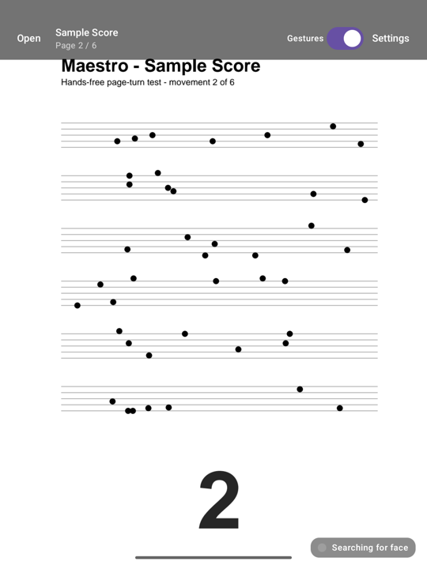
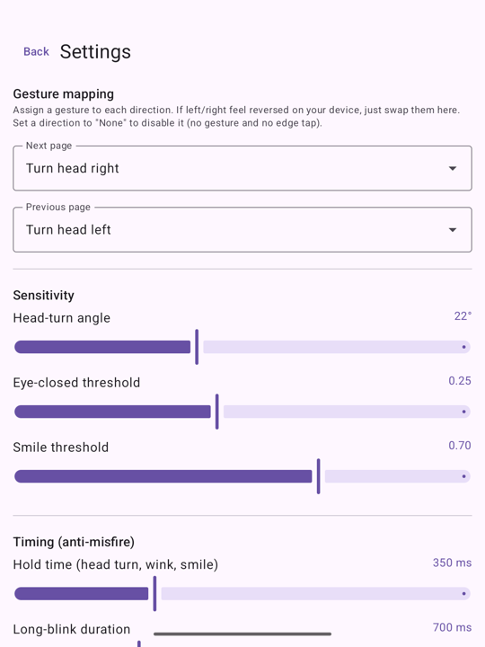

<p align="center"></p>

# Maestro

A hands-free **sheet-music PDF reader** for Android, in the spirit of forScore. Open a
score, prop your tablet on the music stand, and turn pages with a **facial gesture**
(a head turn or a wink) so your hands never leave the instrument.

Face tracking runs **fully on-device and offline** via Google ML Kit's bundled model.
Maestro doesn't request the Internet permission, so neither camera frames nor anything
else can leave the device.

<p align="center">
  
  
</p>

## Install

Download the latest `maestro-<version>.apk` from
[Releases](https://github.com/joshuamontierth/maestro/releases) and open it on your
Android tablet or phone (allow "install unknown apps" for your browser or file manager
when asked). Requires Android 8.0+ on an ARM device (all current phones and tablets) with
a front camera.

## Status

MVP. Open one PDF → render a page (tablet, portrait) → turn pages by gesture, tap, or
the bundled sample. Gesture mapping and sensitivity are fully configurable.
**Double-tap** the page for a clean, immersive full-screen view (hides Maestro's
top controls and the Android system bars; the small gesture-status indicator stays
visible so you still see searching / ready / wait while reading. Double-tap to restore).

## How it works

```
CameraX (front, ImageAnalysis, no preview)
        │  frames
        ▼
FaceAnalyzer ── ML Kit FaceDetector ──► FaceSignals(yaw, leftEyeOpen, rightEyeOpen)
        │
        ▼
GestureEngine (dwell + cooldown + re-arm state machine)
        │  PageAction.NEXT / PREVIOUS
        ▼
ReaderViewModel ──► PdfController (android.graphics.pdf.PdfRenderer) ──► page bitmap
        │
        ▼
ReaderScreen (Jetpack Compose): full-page view, status dot, tap zones, controls
```

- **Gestures** (`face/Gesture.kt`): `HEAD_LEFT/RIGHT` (head yaw), `WINK_LEFT/RIGHT`,
  `BLINK_BOTH` (long blink), `DOUBLE_BLINK` (two quick blinks), and `SMILE`. You assign
  any gesture to *Next* / *Previous* in Settings, so if left/right feel mirrored on your
  device you just swap them. Head turn, wink and smile are held poses (dwell timer);
  long blink and double blink are events from a debounced blink tracker.
- **Anti-misfire** — layered safeguards (sliders in Settings, the rest built in):
  - **Dwell** for held poses: hold ~350 ms before firing; a short grace window keeps
    the hold alive through single dropped frames.
  - **Debounced blink tracking:** the eyes-closed state uses dual thresholds
    (hysteresis) and must persist ≥2 frames / 70 ms before it flips, so one noisy
    ML Kit frame can never fake, split, or end a blink.
  - **Long blink** has its own duration slider (default 700 ms) — comfortably above
    natural blinks (~100–400 ms), which are classified separately and ignored.
  - **Double blink** = two crisp blinks (80–400 ms each) with a clean reopen between
    them, at most 450 ms apart, after ≥200 ms of open eyes — so rapid natural blink
    flutter can't chain into a trigger.
  - **Head-pose gate:** eye and smile gestures are ignored while the head is turned
    >20° or pitched >25° off the camera (e.g. glancing down at the keys), where
    ML Kit's eye probabilities are unreliable.
  - **Cooldown + re-arm:** after a turn, new turns are blocked for ~1.2 s *and* the
    face must return to neutral (eyes open) — so a held pose can't page repeatedly.
- **Status dot** (bottom-right): grey = searching, green = ready, amber = holding,
  blue = cooldown, red = camera permission needed. A small line shows live yaw / pitch /
  eye values to help you tune thresholds (and see when the head-pose gate is active).

## Project layout

| Path | What |
|---|---|
| `app/src/main/java/com/maestro/app/face/Gesture.kt` | Gesture model + `GestureEngine` (pure logic) |
| `…/face/FaceAnalyzer.kt` | ML Kit analyzer → `FaceSignals` |
| `…/face/CameraGesture.kt` | Binds CameraX front camera while detection is active |
| `…/pdf/PdfController.kt` | `PdfRenderer` wrapper → page bitmaps |
| `…/settings/SettingsStore.kt` | DataStore-backed `GestureConfig` |
| `…/ReaderViewModel.kt` | App state: document, pages, detection, config |
| `…/ui/ReaderScreen.kt` | Reader UI |
| `…/ui/SettingsScreen.kt` | Gesture mapping + sensitivity |
| `app/src/test/java/.../face/GestureEngineTest.kt` | Unit tests for the safety logic |
| `app/src/main/assets/sample_score.pdf` | Bundled placeholder score for "Open sample" |

## Build

Requires JDK 17+ and the Android SDK (API 35). Point Gradle at the SDK with
`ANDROID_HOME` or a `local.properties` containing `sdk.dir=/path/to/Android/Sdk`
(Android Studio creates it for you).

```bash
./gradlew :app:assembleDebug        # build app/build/outputs/apk/debug/app-debug.apk
./gradlew :app:testDebugUnitTest    # run gesture-engine unit tests
./gradlew :app:lintDebug            # lint
```

Release builds (`./gradlew :app:assembleRelease`) are minified with R8 and include only
ARM libraries. They are signed with the key named in a `keystore.properties` file at the
repo root (`storeFile`, `storePassword`, `keyAlias`, `keyPassword`; not committed);
without one they fall back to the debug key.

## Run on a device

1. Enable **Developer options → USB debugging** on your Android tablet/phone and plug it in.
2. `adb devices` — confirm it shows up.
3. `adb install -r app/build/outputs/apk/debug/app-debug.apk`
4. Launch **Maestro**, grant the camera permission, tap **Open sample score** (or open
   your own PDF), then use your chosen gesture to flip pages. Tune in **Settings**;
   double-tap the page for immersive full-screen.

Since winking and head-turning can be awkward, good comfortable pairings are
**Next = Smile / Previous = Long blink**, or **Next = Double blink / Previous = Smile**.

## License

[MIT](LICENSE). Face detection uses Google's
[ML Kit](https://developers.google.com/ml-kit), which is distributed under its own
[terms](https://developers.google.com/ml-kit/terms).
